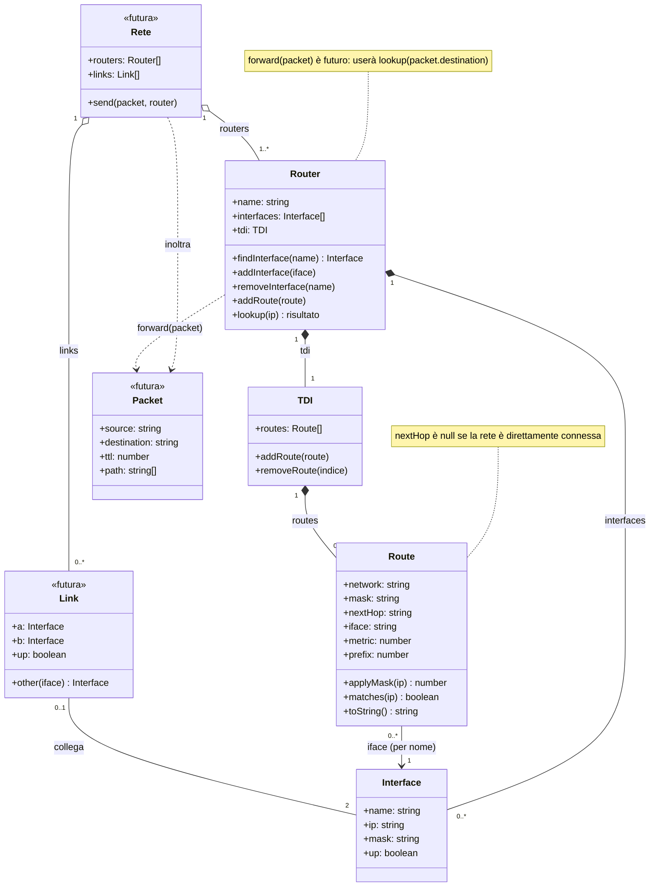
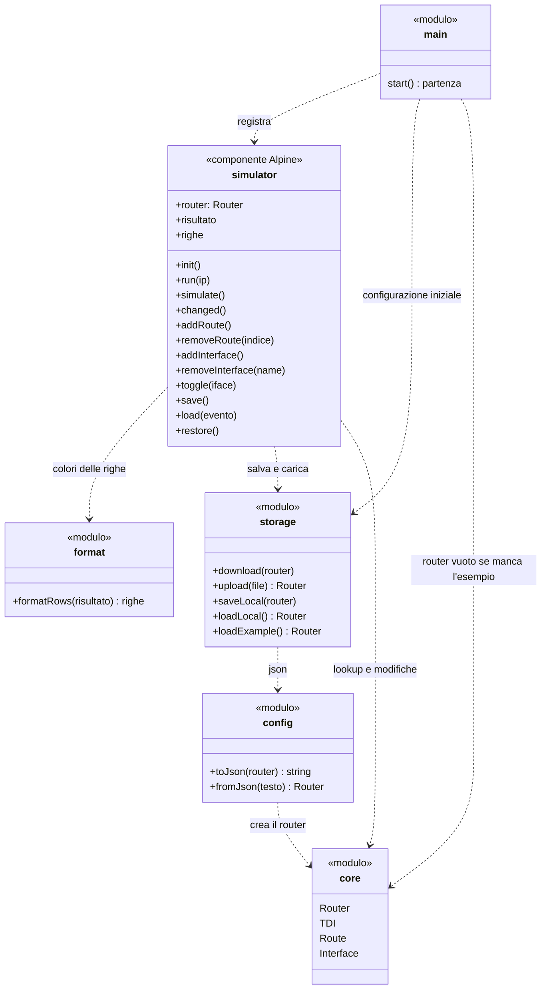

# Diagramma delle classi

Il primo diagramma mostra le classi del core, cioè il modello del router e la logica di instradamento. Le classi marcate `<<futura>>` non sono implementate: servono a far vedere come il progetto può crescere verso una rete con più router collegati (spiegato nella [relazione](RELAZIONE.md#evoluzione-verso-più-router)).

Come si legge:

- un `Router` ha una sola `TDI` e da zero a molte `Interface`. Sono composizioni perché TDI e interfacce esistono solo dentro il loro router.
- la `TDI` contiene le `Route` in un array, nell'ordine in cui sono state inserite.
- ogni `Route` punta a una `Interface` di uscita. Nel codice il collegamento è il nome (`route.iface`), che il router cerca con `findInterface`. Per questo il router non lascia eliminare un'interfaccia usata da una route.
- `Link` collega esattamente due interfacce, e un'interfaccia ha al massimo un link. `Rete` tiene insieme router e link e fa viaggiare un `Packet` da un router all'altro.

## Risultato di lookup

`lookup(ip)` restituisce un oggetto con la route scelta e tutto quello che serve alla pagina per colorare la tabella e scrivere il motivo:

| campo | contenuto |
| --- | --- |
| `ip` | l'indirizzo cercato |
| `controlli` | una voce per ogni route, in ordine di TDI: `{ route, rete, compatibile }`, dove `rete` è IP AND mask |
| `scelta` | la route vincente, oppure `null` |
| `fallback` | le altre route compatibili con interfaccia up, in ordine di preferenza |
| `scartate` | le route compatibili ma con interfaccia down |
| `motivo` | la spiegazione in italiano della scelta |

## Livelli del programma

Il secondo diagramma mostra come sono divisi i file. Persistenza e interfaccia grafica sono moduli di funzioni, non classi, quindi compaiono con lo stereotipo `<<modulo>>`. Le frecce tratteggiate sono dipendenze: la UI usa il core e la persistenza, la persistenza usa il core, il core non usa nessuno dei due.

