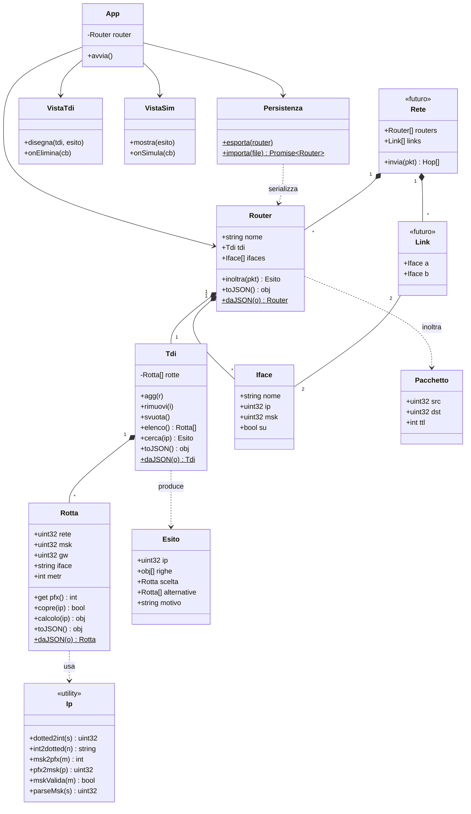

# Simulatore Grafico di Router — Documento di Design

**Data:** 2026-08-15
**Progetto:** ROUTER-GUI
**Materia:** Reti

---

## 1. Obiettivo

Applicazione web con interfaccia grafica che simula un router IP e la sua Tabella di
Instradamento (TDI). L'utente può visualizzare la TDI, inserire ed eliminare route,
salvare e caricare la configurazione da file, e simulare l'instradamento di un pacchetto
verso un indirizzo di destinazione, vedendo **quali regole risultano compatibili, quale
viene scelta e perché**.

Il progetto parte dall'esempio in C di pag. 129 e ne supera i limiti (§ 9).

---

## 2. Vincoli tecnici

| Vincolo | Scelta | Motivo |
|---|---|---|
| Runtime | HTML + CSS + JavaScript vanilla | Nessun build step, nessun `node_modules`. Si consegna una cartella e si apre. |
| Caricamento | `<script>` classici in ordine di dipendenza | Aprendo `index.html` con doppio click il protocollo è `file://`, che **blocca gli ES modules** per la CORS policy. Niente `import`/`export`. |
| Dipendenze esterne | Zero | Deve funzionare offline, su qualsiasi macchina, senza installazioni. |
| Lingua | UI e identificatori in italiano, con anglicismi dove sono la parola giusta (`gw`, `iface`, `pkt`) | Coerenza con la traccia e con il progetto ISO-OSI in C. |
| Stile identificatori | Abbreviato, minuscolo dove possibile. Classi in `PascalCase` (convenzione JS). | Leggibilità senza verbosità. |

### 2.1 Stile del codice

Il codice deve sembrare scritto da uno studente bravo, non generato. In pratica, per chi
implementa:

- **Commenti dove un umano si fermerebbe davvero a spiegare**, non uno per metodo. I punti
  che meritano un commento sono pochi e identificabili: la trappola del `>>> 0`, il motivo
  della scansione lineare invece del trie, il test di contiguità della mask. Il resto del
  codice si spiega da solo e non va annotato.
- **Densità irregolare.** Alcune funzioni restano nude, una o due hanno una nota più lunga.
  Ogni file allo stesso stampo è il segnale più evidente di codice generato.
- **Un pizzico di ironia, ma solo nei commenti.** Mai negli identificatori, mai nelle
  stringhe dell'interfaccia — quelle le legge il professore e devono restare serie.

---

## 3. Strutture dati — scelta e motivazione

Questa sezione risponde al vincolo progettuale *«la scelta delle strutture dati dovrà
essere motivata e coerente con il problema da risolvere»*.

### 3.1 Rappresentazione degli indirizzi: `uint32`, non quattro ottetti separati

L'esempio di pag. 129 memorizza **sedici** `unsigned char` per riga (4 per l'indirizzo,
4 per la mask, 4 per il gateway, 4 per l'interfaccia). Ogni operazione richiede poi una
funzione `DottedToDecimal` che ricostruisce a mano il numero a 32 bit:

```c
ul = a*0x1000000 + b*0x10000 + c*0x100 + d;
```

Cioè: il dato viene **smontato** per essere memorizzato e **rimontato** ad ogni uso.

Scelta di questo progetto: **un indirizzo IPv4 è un intero senza segno a 32 bit.**
La notazione dotted (`192.168.1.0`) è solo una *rappresentazione testuale* che esiste
al confine di input/output — nel form quando l'utente digita, nella tabella quando si
disegna. Dentro la logica circolano numeri.

Conseguenze dirette:

| Operazione | Con 4 ottetti | Con `uint32` |
|---|---|---|
| Applicare la mask | ricostruire 2 interi, poi AND | `ip & msk` |
| Confrontare con la rete | ricostruire un altro intero | `=== rete` |
| Lunghezza del prefisso | contare bit ottetto per ottetto | `popcount` su un intero |
| Ordinare per prefisso | confronto a 4 livelli | confronto tra due numeri |

**Insidia specifica di JavaScript.** Gli operatori bit a bit di JS lavorano su interi a
32 bit **con segno**: `255.255.255.0` vale `0xFFFFFF00`, che letto come signed è
negativo. `(ip & msk) === rete` resta corretto *purché tutti e tre i valori passino per
la stessa conversione*, ma ogni volta che un valore viene **mostrato o ordinato** va
normalizzato con `>>> 0` (shift logico a destra di zero, che forza l'interpretazione
unsigned). Questa regola vale in tutto il codice ed è la fonte di bug numero uno in
questo tipo di progetto.

### 3.2 Struttura della TDI: array con scansione lineare

Tre alternative valutate:

| Struttura | Costo lookup | Valutazione |
|---|---|---|
| **Array + scansione lineare** ✅ | O(n) | **Scelta.** Vedi sotto. |
| Array ordinato per prefisso decrescente | O(n) con uscita anticipata | L'uscita anticipata al primo match farebbe perdere l'elenco delle route alternative, che va comunque mostrato: la scansione andrebbe completata lo stesso. Guadagno nullo, complessità aggiunta sull'inserimento. |
| Trie binario / Patricia trie | O(32) | È ciò che usa un router reale (dove n vale centinaia di migliaia). Qui n è dell'ordine delle decine: il costo asintotico è irrilevante. Soprattutto, un trie **nasconde** la valutazione regola-per-regola, che in questo progetto è il contenuto didattico da mostrare. |

**Motivazione della scelta.** Il requisito *«individuare tutte le route compatibili,
magari evidenziandole sulla TDI»* non è un dettaglio di presentazione: impone che
l'algoritmo **visiti ogni regola e conservi l'esito di ogni confronto**. Una struttura
che salta le regole non compatibili — che è esattamente il vantaggio di un trie — non
può produrre quell'informazione. Qui la scansione lineare *è* la visualizzazione:
ogni iterazione corrisponde a una riga della tabella da colorare.

La complessità O(n) è accettabile perché n è piccolo per costruzione (una TDI didattica
compilata a mano). Il trie viene comunque documentato nel progetto come "ciò che farebbe
un router reale", perché la domanda *perché non un trie* è più interessante della
risposta.

### 3.3 Esito del lookup: oggetto strutturato, non stringhe

`Tdi.cerca(ip)` non restituisce la route vincente, ma un oggetto `Esito` che contiene:

`Esito` non è una classe: è un **oggetto semplice** costruito e restituito da
`Tdi.cerca()`. Nel diagramma compare come classe solo per documentarne la forma. Non ha
comportamento proprio, quindi non merita un costruttore né un file.

- `righe[]` — una voce **per ogni regola della TDI**, con il calcolo intermedio
  (`ip & msk`, il confronto con `rete`, l'esito vero/falso). È lo stesso contenuto che il
  programma C stampava con `printf`, ma come **dato**, non come testo già formattato.
- `scelta` — la route vincente secondo Longest Prefix Match
- `alternative[]` — le altre route compatibili, ordinate per preferenza (fallback)
- `motivo` — la spiegazione testuale della scelta

Questa è la scelta architetturale centrale del progetto: **la spiegazione è prodotta
dalla logica, non assemblata nel DOM.** La vista riceve un `Esito` già completo e si
limita a disegnarlo. Il vantaggio pratico: la logica di instradamento resta testabile
senza browser, e la stessa spiegazione potrà essere riutilizzata da una vista diversa
(console, log multi-hop) senza riscriverla.

---

## 4. Architettura — tre strati

La traccia richiede di separare interfaccia grafica, logica di instradamento e gestione
della persistenza. Separazione realizzata così:

| Strato | File | Regola ferrea |
|---|---|---|
| **Logica** | `ip.js`, `rotta.js`, `tdi.js`, `iface.js`, `router.js`, `pacchetto.js` | **Zero DOM.** Nessun riferimento a `document`, `window`, elementi HTML. Deve poter girare in un test senza pagina. |
| **Persistenza** | `persistenza.js` | Traduce fra oggetti del dominio e JSON. Non conosce la vista. |
| **Vista** | `vista-tdi.js`, `vista-sim.js`, `app.js` | **Zero aritmetica IP.** Non fa AND, non converte dotted, non ordina per prefisso. Riceve dati già elaborati e li disegna. |

La regola *zero DOM nella logica / zero aritmetica nella vista* è verificabile: basta
cercare `document` nei file di logica e `&`/`>>>` nei file di vista. Se compaiono, il
confine è stato violato.

### 4.1 Diagramma delle classi



### 4.2 Responsabilità delle classi

**`Ip`** — modulo di utilità (oggetto con soli metodi statici, non si istanzia).
Unico punto del programma che conosce la notazione dotted. Converte, valida, calcola
lunghezza di prefisso. Tutto il resto del codice parla in `uint32`.

**`Rotta`** — oggetto-valore, una riga della TDI. Campi: `rete`, `msk`, `gw`, `iface`,
`metr`. Il gateway `0.0.0.0` significa *rete direttamente connessa* (nessun next hop).
`pfx` è una property derivata da `msk`. Due metodi chiave:
- `copre(ip)` → booleano, il test `(ip & msk) >>> 0 === rete`
- `calcolo(ip)` → l'oggetto con i valori intermedi, per la spiegazione

**`Tdi`** — contenitore di `Rotta`. Gestisce inserimento (con validazione e controllo
duplicati), rimozione, svuotamento, e soprattutto `cerca(ip)` che implementa il Longest
Prefix Match producendo l'`Esito`.

**`Iface`** — interfaccia di rete: nome, indirizzo, mask, stato su/giù. Nel simulatore
mono-router è quasi uno scheletro: serve a dare un tipo alla colonna "Use" della TDI,
che nel codice C era una stringa di ottetti senza significato. **La sua esistenza ora è
ciò che rende credibile l'evoluzione multi-hop** (§ 8): un `Link` collega due `Iface`,
non due stringhe.

**`Router`** — possiede una `Tdi` e un insieme di `Iface`, ha un nome. `inoltra(pkt)`
delega a `tdi.cerca(pkt.dst)`. Nel mono-router è un wrapper sottile; nel multi-router
diventa il nodo del grafo.

**`Pacchetto`** — sorgente, destinazione, TTL. Minimo ma presente: nel mono-router serve
solo `dst`, ma introdurlo ora evita di cambiare la firma di `inoltra()` quando arriverà
il forwarding multi-hop.

**`Persistenza`** — serializza e deserializza. Vedi § 6.

**`VistaTdi`, `VistaSim`, `App`** — rendering e gestione eventi. `App` è il controller:
tiene il `Router`, collega i callback delle viste ai metodi del dominio, richiede il
ridisegno.

---

## 5. Algoritmo di instradamento

`Tdi.cerca(ip)` in un'unica passata:

1. **Scansione.** Per ogni `Rotta` della tabella calcola `(ip & msk) >>> 0` e lo confronta
   con `rete`. Registra in `righe[]` la regola, i valori intermedi e l'esito. *Nessuna
   regola viene saltata* — serve l'elenco completo per l'evidenziazione.
2. **Filtro.** Estrae le route compatibili (quelle con esito vero).
3. **Ordinamento.** Ordina i match per `pfx` **decrescente**, e a parità di prefisso per
   `metr` **crescente**. Se anche la metrica pareggia decide l'ordine di inserimento in
   tabella: `Array.prototype.sort` è garantito stabile da ES2019, quindi non serve alcun
   accorgimento.

   Il pareggio sul prefisso si verifica quando la TDI contiene due rotte verso la stessa
   destinazione con gateway diversi (§ 7): è la configurazione di riserva, e la metrica è
   ciò che stabilisce quale percorso è il principale e quale il fallback.
4. **Selezione.** Il primo è `scelta`. I rimanenti sono `alternative` — le route
   utilizzabili come fallback / fault tolerance.
5. **Motivazione.** Compone il testo: quale prefisso ha vinto, di quanti bit, e — se
   c'era pareggio sul prefisso — che la metrica ha deciso.

**Il ruolo della default route.** `0.0.0.0/0` ha `msk = 0`, quindi `ip & 0 === 0` è vero
per *qualunque* indirizzo: è compatibile sempre. Ma `pfx = 0` è il minimo possibile,
quindi l'ordinamento la colloca **sempre per ultima**. È precisamente il comportamento di
fallback richiesto dalla traccia, e non serve trattarla come caso speciale: emerge
dall'algoritmo. Nell'esempio di pag. 129 la default c'è, ma il programma non arriva mai a
spiegarne il senso perché non ordina nulla.

**Nessun match.** Se `match` è vuoto — cosa possibile solo se la TDI non contiene una
default route — l'esito riporta `scelta: null` e motivo *«destinazione irraggiungibile»*.
È ciò che fa un router reale, che scarta il pacchetto ed eventualmente emette un ICMP
*network unreachable*.

---

## 6. Persistenza

**Vincolo del browser: una pagina web non può scrivere su disco.** Non esiste API per
sovrascrivere un file. Quindi:

| Operazione | Meccanismo |
|---|---|
| **Salva** | Serializza in JSON → crea un `Blob` → genera un `<a download="config.json">` → click programmatico. Il browser scarica il file. |
| **Carica** | `<input type="file">` → `FileReader.readAsText()` → `JSON.parse` → `Router.daJSON()` |

`localStorage` **non** soddisfa il requisito «salvare e caricare la configurazione da
file»: è memoria interna del browser, non un file. Non viene usato.

**Cosa viene serializzato: il `Router` intero, non solo la `Tdi`.** Il formato è:

```json
{
  "versione": 1,
  "router": {
    "nome": "R1",
    "ifaces": [ { "nome": "eth0", "ip": "192.168.1.1", "msk": "255.255.255.0", "su": true } ],
    "tdi": [
      { "rete": "192.168.1.0", "msk": "255.255.255.0", "gw": "0.0.0.0", "iface": "eth0", "metr": 1 }
    ]
  }
}
```

Motivo della scelta: un file di configurazione multi-router sarà
`{ "versione": 2, "routers": [...], "links": [...] }` — un **superset** di questo. Il
codice di caricamento potrà accettare entrambi i formati con un `if` sulla versione,
senza migrazione né rottura dei file salvati oggi.

Nel JSON gli indirizzi sono salvati in **notazione dotted**, non come interi: il file
deve restare leggibile e modificabile a mano con un editor di testo. La conversione
avviene in serializzazione/deserializzazione.

---

## 7. Gestione degli errori

| Caso | Comportamento |
|---|---|
| IP malformato | Validazione: esattamente 4 ottetti, ognuno intero 0–255, nessun carattere estraneo. Messaggio inline nel form, campo evidenziato. |
| Mask non contigua (`255.0.255.0`) | **Rifiutata.** Test: `~msk + 1` deve essere una potenza di due (o zero). Una netmask valida è una sequenza di 1 seguita da una sequenza di 0. |
| Mask in notazione `/24` | Accettata: il form accetta sia dotted sia CIDR e normalizza. |
| Rotta identica (stessa `rete` + `msk` + `gw`) | **Rifiutata.** È pura ridondanza: due volte la stessa istruzione. |
| Stessa destinazione, gateway diverso (`192.168.1.0/24` via A metrica 1, via B metrica 10) | **Ammessa, ed è il caso interessante.** È la *floating static route*: stesso prefisso, percorso di riserva. Decide la metrica. Se si rifiutasse questa configurazione il campo `metr` non servirebbe a nulla, perché due rotte con lo stesso prefisso che coprono lo stesso indirizzo hanno necessariamente la stessa rete e la stessa mask — il pareggio sul prefisso non potrebbe mai verificarsi. È qui che nascono le «route alternative utilizzabili come fallback» richieste dalla traccia. |
| JSON malformato o versione ignota in caricamento | Messaggio d'errore, **lo stato corrente resta intatto**. Mai lasciare l'applicazione in stato parziale. |
| Nessuna route compatibile | Non è un errore del programma: è un esito legittimo. «Destinazione irraggiungibile». |
| Overflow di segno nei bitwise | Prevenuto sistematicamente con `>>> 0` prima di ogni visualizzazione o confronto d'ordine. |

---

## 8. Evoluzione verso il multi-router

Risposta alla domanda della traccia: *«quali classi sarebbero necessarie? quali relazioni
esisterebbero tra esse?»*

**Classi da aggiungere:**

- **`Rete`** — il grafo. Contiene `Router[]` e `Link[]`. Espone `invia(pkt)` che
  restituisce l'elenco degli hop attraversati.
- **`Link`** — arco del grafo, collega **due `Iface`**. Eventualmente con proprietà di
  banda, ritardo, stato su/giù (per simulare guasti e vedere entrare in azione le route
  alternative — che è il motivo per cui la metrica esiste già ora).
- **`Pacchetto`** — già presente, guadagna un uso reale del `ttl`.

**Relazioni:**

```
Rete  1 ──── *  Router      (composizione)
Rete  1 ──── *  Link        (composizione)
Link  2 ──── 2  Iface       (associazione: un link unisce due interfacce)
Router 1 ──── * Iface       (composizione, già presente)
Router 1 ──── 1 Tdi         (composizione, già presente)
Tdi   1 ──── * Rotta        (composizione, già presente)
Rotta * ──── 1 Iface        (interfaccia d'uscita, per nome — risolta dal Router)
```

**`Rotta.iface` resta una stringa, anche nel multi-router.** Una riga di TDI cita
l'interfaccia d'uscita per nome (`"eth0"`), esattamente come fa un router reale; è il
`Router` che possiede la mappa nome → `Iface` e la risolve al momento dell'inoltro. Così
`Rotta` resta un oggetto-valore serializzabile senza dipendenze, e non deve cambiare tipo
quando arriva `Rete`.

**Algoritmo di forwarding multi-hop** (`Rete.invia`):

```
finché pkt.ttl > 0:
    esito = routerCorrente.inoltra(pkt)
    se esito.scelta è null: → pacchetto scartato, "unreachable"
    ifaceUscita = esito.scelta.iface
    link = trova il Link che tocca ifaceUscita
    se link è giù: → prova esito.alternative, altrimenti scarta
    ifaceRemota = l'altro capo del link
    routerCorrente = router che possiede ifaceRemota
    pkt.ttl--
    registra l'hop
    se routerCorrente possiede pkt.dst: → consegnato
```

**Cosa cambia nelle classi esistenti: nulla.** `Ip`, `Rotta`, `Tdi`, `Iface`, `Router`
restano come sono. `Rete` e `Link` si aggiungono sopra, e `Rete.invia` chiama in un ciclo
lo stesso `Router.inoltra` già scritto oggi. L'algoritmo LPM, l'`Esito` con la sua
spiegazione, la conversione degli indirizzi — tutto viene riutilizzato tale e quale ad
ogni hop. **È questa la verifica che
la progettazione è corretta:** l'introduzione di `Rete`, `Link` e del forwarding
multi-hop non richiede di riscrivere la logica di instradamento, solo di chiamarla in un
ciclo.

---

## 9. Analisi dei limiti dell'esempio di pag. 129

La traccia chiede di *«studiare il codice di esempio visto a lezione e analizzarne i
limiti e le possibili evoluzioni»*. Analisi:

| # | Limite | Evoluzione adottata in questo progetto |
|---|---|---|
| 1 | **Non implementa il Longest Prefix Match.** Stampa `vera`/`falsa` per ogni regola e termina. Non sceglie mai una route: manca esattamente il cuore dell'instradamento. | `Tdi.cerca()` ordina i match per lunghezza di prefisso e seleziona il vincitore. |
| 2 | **Sedici `unsigned char` per riga** invece di quattro interi a 32 bit. Il dato viene smontato per essere memorizzato e ricostruito a ogni operazione da `DottedToDecimal`. | Indirizzi come `uint32`; il dotted vive solo al confine di I/O (§ 3.1). |
| 3 | **TDI hardcoded a compile-time** in un array inizializzato nel sorgente. Aggiungere una route richiede di ricompilare. | `Tdi.agg()` / `Tdi.rimuovi()`, con form grafico. |
| 4 | **Nessuna metrica, nessun criterio di pareggio.** Due route con lo stesso prefisso sono indistinguibili. | Campo `metr`, usato come secondo criterio d'ordinamento. |
| 5 | **La colonna "Use" è una stringa di ottetti**, non un'astrazione di interfaccia: non ha comportamento, non può essere collegata a nulla. | Classe `Iface`, con nome, indirizzo e stato — collegabile a un `Link`. |
| 6 | **Zero validazione.** Accetta mask non contigue e indirizzi fuori range senza accorgersene. | Validazione su IP e contiguità della mask (§ 7). |
| 7 | **Nessuna persistenza.** La configurazione muore con il processo. | Esportazione/importazione JSON (§ 6). |
| 8 | **Si intitola "instradamento classful" ma esegue mascheratura classless.** Le classi A/B/C non compaiono da nessuna parte nel codice: c'è solo AND con una netmask esplicita, che è CIDR. La discrepanza fra titolo e codice è didatticamente confondente. | Il progetto è dichiaratamente classless (CIDR), con lunghezza di prefisso esplicita. |
| 9 | **La default route `0.0.0.0/0` è presente ma il suo ruolo non emerge mai**, perché senza ordinamento non si vede che è l'ultima scelta possibile. | L'ordinamento per prefisso la colloca naturalmente in fondo; l'UI la etichetta come fallback (§ 5). |
| 10 | **Nessuna separazione delle responsabilità.** Struttura dati, logica di confronto e output (`printf`) sono intrecciati nello stesso ciclo `for`. | Tre strati con confini verificabili (§ 4). |

---

## 10. Interfaccia utente

Pagina unica, tre zone:

**Zona TDI** — tabella con colonne *Rete · Mask (/pfx) · Gateway · Interfaccia · Metrica ·
azioni*. Sotto, il form di inserimento (rete, mask o `/n`, gateway, interfaccia, metrica)
e i pulsanti *Salva su file* / *Carica da file*.

**Zona simulazione** — campo per l'indirizzo di destinazione, pulsante *Instrada*.

**Zona esito** — dopo la simulazione:
- la **tabella TDI si colora**: verde = route scelta, giallo = alternative compatibili,
  grigio = regole non compatibili;
- per ogni riga si può espandere il **calcolo**: `ip & msk` = risultato, confrontato con
  `rete`, esito vero/falso — la stessa informazione del `printf` del programma C, ma
  leggibile;
- un **riquadro di motivazione** riporta la scelta in parole: quale route ha vinto, con
  quale lunghezza di prefisso, quante alternative esistono e in che ordine sarebbero
  usate in caso di guasto.

Nessun framework CSS. Foglio di stile scritto a mano, leggibile.

---

## 11. Struttura dei file

L'ordine dei `<script>` in `index.html` è vincolante (niente moduli → niente risoluzione
automatica delle dipendenze). Dal più basso livello al più alto:

```
ROUTER-GUI/
├── index.html              pagina principale + <script> in ordine
├── test.html               pagina di test
├── css/
│   └── stile.css
├── js/
│   ├── ip.js               utility di conversione e validazione
│   ├── rotta.js            class Rotta
│   ├── tdi.js              class Tdi  (+ costruzione dell'Esito)
│   ├── iface.js            class Iface
│   ├── pacchetto.js        class Pacchetto
│   ├── router.js           class Router
│   ├── persistenza.js      export/import JSON
│   ├── vista-tdi.js        rendering della tabella
│   ├── vista-sim.js        pannello di simulazione ed esito
│   └── app.js              controller, wiring, avvio
├── test/
│   └── test.js             asserzioni
└── docs/
    └── superpowers/specs/  questo documento
```

---

## 12. Test

Nessun framework: introdurre Jest significherebbe introdurre `npm`, e con esso un build
step che il vincolo di consegna esclude.

`test.html` carica gli stessi file di logica di `index.html` più `test/test.js`, che
contiene un mini-runner di asserzioni (una funzione `ok(desc, cond)` che stampa una lista
verde/rossa). Si apre con doppio click e in due secondi si vede se qualcosa è rotto.

Casi coperti:

- `Ip` — `dotted2int` / `int2dotted` sono l'una l'inversa dell'altra; `255.255.255.255`
  non diventa negativo; `msk2pfx` su `/0`, `/24`, `/32`; rifiuto di `256.1.1.1` e di
  `1.2.3`.
- `Rotta.copre` — match esatto, non-match, default route che copre tutto.
- `Tdi.cerca` — LPM sceglie `/24` contro `/16`; a parità di prefisso vince la metrica
  minore; la default route finisce ultima fra le alternative; TDI senza default e senza
  match → `scelta === null`; l'elenco `righe` ha sempre lunghezza pari al numero di route.
- Validazione — mask non contigua rifiutata; inserimento duplicato segnalato.
- Persistenza — `daJSON(toJSON(r))` restituisce un router equivalente (round-trip).

---

## 13. Riepilogo delle decisioni

1. Indirizzi come `uint32`, dotted solo al confine I/O — con `>>> 0` sistematico.
2. TDI come array con scansione lineare completa: il requisito di mostrare *tutte* le
   route compatibili esclude le strutture che saltano regole.
3. `Tdi.cerca()` restituisce un `Esito` che contiene anche la spiegazione: la
   motivazione nasce nella logica, non nel DOM.
4. Tre strati con confini verificabili meccanicamente (niente `document` nella logica,
   niente bitwise nella vista).
5. Persistenza via Blob/download e FileReader, serializzando il `Router` intero perché il
   formato multi-router sia un superset di quello attuale.
6. `Iface` e `Pacchetto` presenti fin da subito, anche se scheletrici: sono ciò che rende
   l'evoluzione multi-hop una questione di aggiunta, non di riscrittura.
