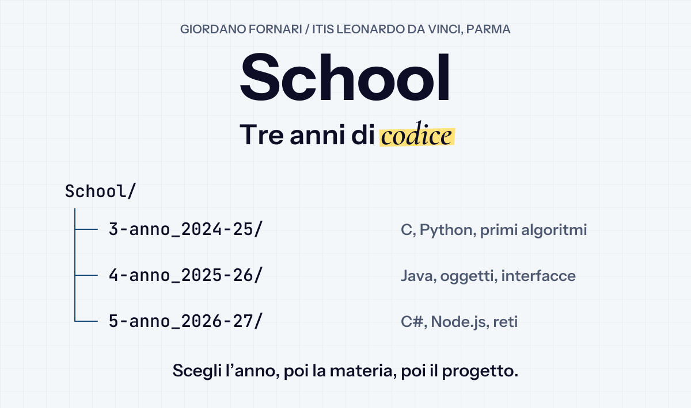
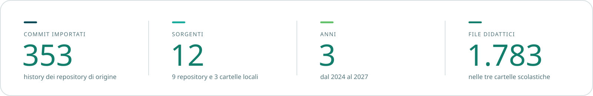
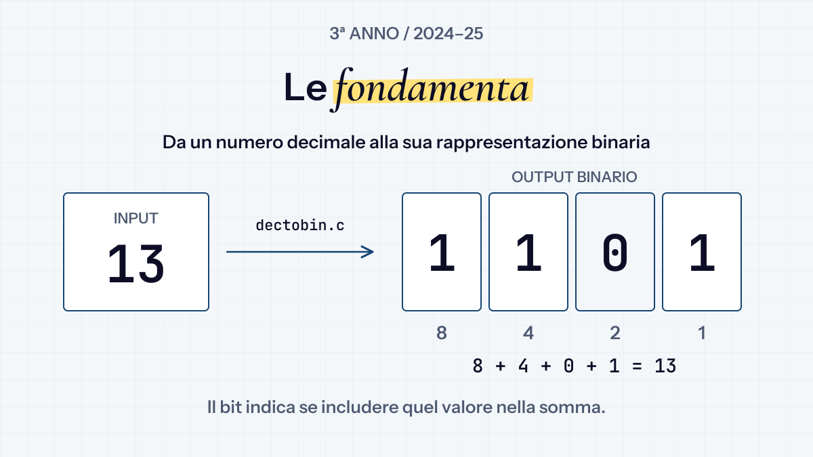
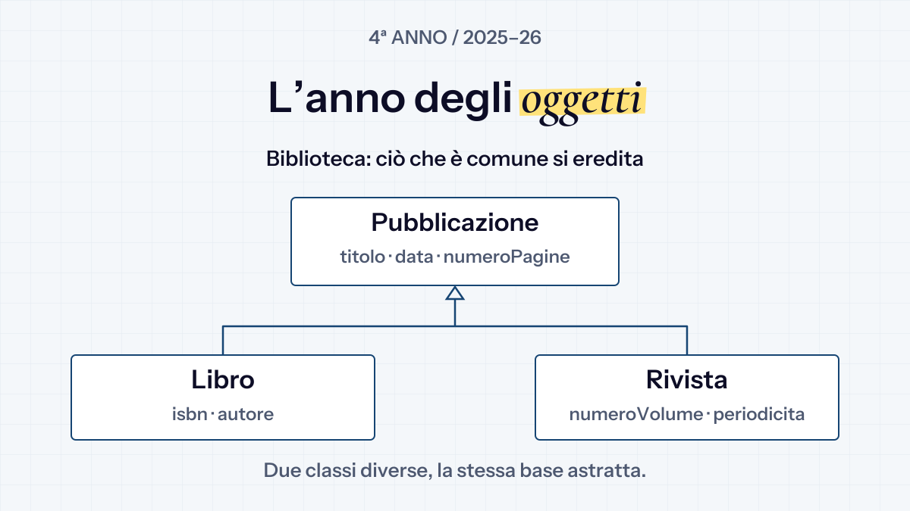
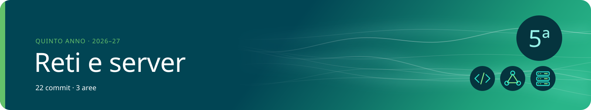
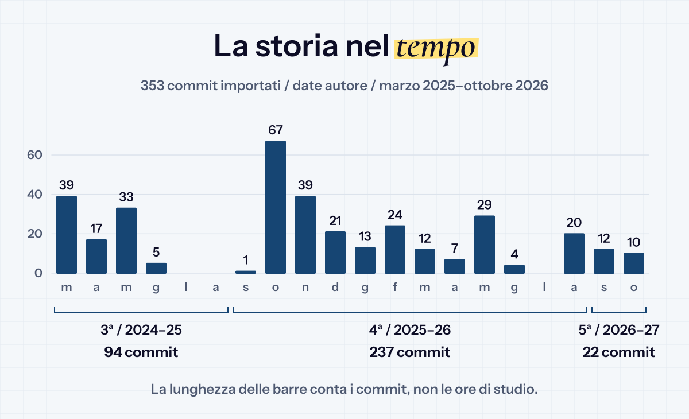
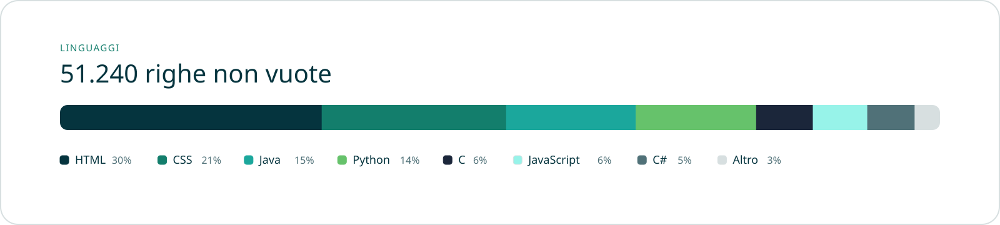
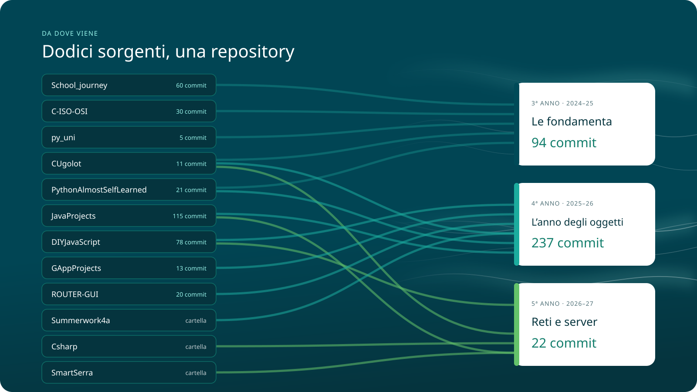

<p align="center">
  
</p>

# School

Il mio percorso all’**ITIS Leonardo da Vinci di Parma**, indirizzo Informatica: esercizi, verifiche, laboratori e progetti. Dal primo programma in C e Python alle interfacce grafiche, alle reti e ai server web.

**[Terzo anno](#terzo-anno) · [Quarto anno](#quarto-anno) · [Quinto anno](#quinto-anno) · [Progetti da esplorare](#progetti-da-esplorare) · [Le origini](#le-origini)**



## Come orientarsi

**Anno → materia → progetto.** Ogni cartella contiene il materiale di un anno scolastico, da settembre ad agosto. Dentro trovi il codice e, dove presenti, consegne, relazioni e istruzioni del singolo progetto.

|  Informatica |  Sistemi e reti |  TPSIT |
| :--- | :--- | :--- |
| Programmazione, oggetti e interfacce. | C, protocolli, subnetting e reti simulate. | Web, JavaScript, stream e server. |
| Python · Java · C# · Dart | C · Packet Tracer · IoT | HTML · CSS · JavaScript · Node.js |

È un archivio di lavoro scolastico: gli esercizi hanno requisiti e strumenti diversi. Per eseguirli, parti dalla cartella del progetto e dal suo README; non c’è un’installazione unica per tutta la repo.

## Terzo anno

<a href="3-anno_2024-25"></a>

I primi algoritmi, la programmazione procedurale e il funzionamento delle reti. Accanto agli esercizi, le challenge di sicurezza e il PCTO all’Università di Parma.

| Area | Cosa trovi |
| :--- | :--- |
| [Informatica / Python](3-anno_2024-25/Informatica/Python) | Esercizi, Codewars, turtle e piccoli giochi. |
| [Sistemi / C](3-anno_2024-25/Sistemi/C) | Programmazione in C e compilazione con gcc. |
| [Sistemi / ISO-OSI](3-anno_2024-25/Sistemi/C-ISO-OSI) | Simulazione dello stack di rete in C, progetto di gruppo. |
| [TPSIT](3-anno_2024-25/TPSIT) | HTML e file batch. |
|  [Attacco-Difesa](3-anno_2024-25/Attacco-Difesa) | Challenge e servizi da analizzare e difendere. |
|  [PCTO / UniPR](3-anno_2024-25/PCTO/UniPR-Python) | Attività Python all’Università di Parma. |
|  [Estate](3-anno_2024-25/Estate/Sistemi-compiti-estivi) | Compiti estivi di Sistemi. |

## Quarto anno

<a href="4-anno_2025-26"></a>

Classi, ereditarietà e applicazioni più strutturate. Si passa dagli esercizi Java e Python alle app Flutter, fino ai progetti estivi e a un simulatore di routing nel browser.

| Area | Cosa trovi |
| :--- | :--- |
| [Informatica / Java](4-anno_2025-26/Informatica/Java) | Esercizi, laboratori e verifiche sulla programmazione a oggetti. |
| [Informatica / Python](4-anno_2025-26/Informatica/Python) | OOP, cataloghi e progetti. |
|  [Laboratorio / Flutter](4-anno_2025-26/Informatica/Laboratorio/Flutter) | Interfacce e applicazioni con Dart e Flutter. |
| [Sistemi / C](4-anno_2025-26/Sistemi/C) | Strutture dati in C. |
| [TPSIT / JavaScript](4-anno_2025-26/TPSIT/JavaScript) | Fondamenti, form, thread e client. |
| [Estate](4-anno_2025-26/Estate) | Summerwork4a e ROUTER-GUI. |

## Quinto anno

<a href="5-anno_2026-27"></a>

**In corso.** Applicazioni console e desktop con C#, server con Node.js e progettazione di reti: il materiale cresce insieme all’anno scolastico.

| Area | Cosa trovi |
| :--- | :--- |
| [Informatica / C#](5-anno_2026-27/Informatica/CSharp) | Console, librerie di classi e Windows Forms. |
| [Informatica / Java](5-anno_2026-27/Informatica/Java) | Esercizi e progetti, inclusi quelli C# conservati nei percorsi della repo originale. |
| [Sistemi / Subnet-Tool](5-anno_2026-27/Sistemi/Subnet-Tool) | Strumenti per il subnetting. |
| [Sistemi / SmartSerra](5-anno_2026-27/Sistemi/SmartSerra) | Progetto di rete con Packet Tracer e IoT. |
| [TPSIT / JavaScript](5-anno_2026-27/TPSIT/JavaScript) | Server web e gestione degli stream. |

## Progetti da esplorare

| Progetto | Da dove partire |
| :--- | :--- |
| **[ROUTER-GUI](4-anno_2025-26/Estate/ROUTER-GUI)** | Simulatore di routing con interfaccia nel browser. |
| **[ISO/OSI in C](3-anno_2024-25/Sistemi/C-ISO-OSI)** | Un progetto di gruppo per rappresentare lo stack di rete. |
| **[SmartSerra](5-anno_2026-27/Sistemi/SmartSerra)** | Rete e IoT applicati a una serra in Packet Tracer. |
| **[Biblioteca WinForms](5-anno_2026-27/Informatica/CSharp/05_Biblioteca_WinForms)** | Una libreria di classi collegata a un’interfaccia desktop. |
| **[Summerwork4a](4-anno_2025-26/Estate/Summerwork4a)** | Porting Python, smart home e attività estive. |
| **[UniPR Python](3-anno_2024-25/PCTO/UniPR-Python)** | Il percorso PCTO, organizzato per giornata. |

## Il percorso, in numeri



Il grafico racconta la **history importata prima dell’unificazione del 30 ottobre 2026**, usando le date originali dei commit. Non misura ore di studio o difficoltà dei progetti.



Il conteggio dei linguaggi comprende anche commenti e markup; esclude le cartelle di piattaforma Flutter, dipendenze, build e documentazione riconosciute dal generatore. È una fotografia del materiale, non una misura dell’esperienza.

## Le origini



Nove repository e tre cartelle locali sono confluite qui. Le repository originali sono archiviate; i commit importati mantengono autori e date, con hash cambiati dalla riorganizzazione dei percorsi. Le tre cartelle locali sono state aggiunte senza una history precedente.

<details>
<summary><strong>Mappa delle repository originali</strong></summary>

| Repository originale | Percorso in School |
| :--- | :--- |
| [School_journey](https://github.com/giofornari/School_journey) | `3-anno_2024-25/`: Attacco-Difesa, Informatica, Sistemi e TPSIT. |
| [CUgolot](https://github.com/giofornari/CUgolot) | Sistemi/C del 3° e 4° anno, compiti estivi del 3°, Subnet-Tool del 5°. |
| [C-ISO-OSI](https://github.com/giofornari/C-ISO-OSI) | `3-anno_2024-25/Sistemi/C-ISO-OSI`. |
| [py_uni](https://github.com/giofornari/py_uni) | `3-anno_2024-25/PCTO/UniPR-Python`. |
| [PythonAlmostSelfLearned](https://github.com/giofornari/PythonAlmostSelfLearned) | Informatica/Python del 3° e 4° anno. |
| [JavaProjects](https://github.com/giofornari/JavaProjects) | Informatica/Java del 4° e 5° anno. |
| [DIYJavaScript](https://github.com/giofornari/DIYJavaScript) | TPSIT/JavaScript del 4° e 5° anno. |
| [GAppProjects](https://github.com/giofornari/GAppProjects) | `4-anno_2025-26/Informatica/Laboratorio/Flutter`. |
| [ROUTER-GUI](https://github.com/giofornari/ROUTER-GUI) | `4-anno_2025-26/Estate/ROUTER-GUI`. |

Le cartelle locali **Summerwork4a**, **Csharp** e **SmartSerra** completano l’archivio. Le repository che coprivano più anni sono state divise in base alla data di creazione delle cartelle.

Per risalire alla storia di un file, dalla radice della repo:

```bash
git log --follow -- percorso/del/file
```

</details>

<details>
<summary><strong>Come rigenerare le grafiche</strong></summary>

Banner, icone e infografiche sono SVG locali, con Poppins incorporato e palette ispirata a DCS Academy. Il generatore e le note sui conteggi sono in **[.github/readme](.github/readme/README.md)**.

</details>


