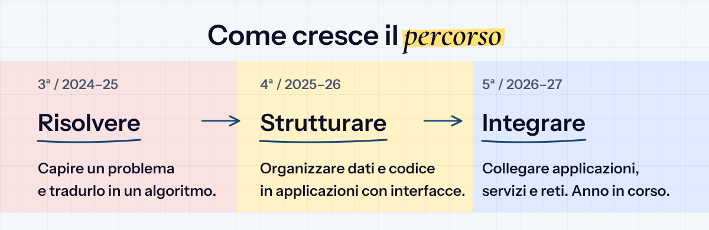
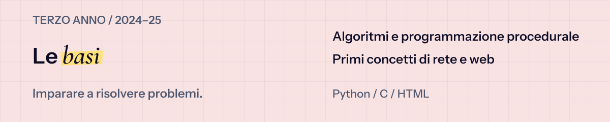

  

# Tre anni di Informatica

Esercizi, laboratori e verifiche raccontano il passaggio dai primi algoritmi alle applicazioni e alle reti. Scegli un anno per seguire il percorso, oppure una materia per trovare subito il codice.

**Vai a:** [Il percorso](#il-percorso) · [Terzo anno](#terzo-anno) · [Quarto anno](#quarto-anno) · [Quinto anno](#quinto-anno)

## Il percorso

## Materiale per anno

Ogni anno raccoglie le attività delle tre materie principali; le altre esperienze sono indicate a parte.

### Terzo anno

| Materia | Argomenti |
| :--- | :--- |
| [Informatica](3-anno_2024-25/Informatica) | Sequenze, condizioni, cicli e funzioni in Python. |
| [Sistemi e reti](3-anno_2024-25/Sistemi) | Compilazione in C e modelli di comunicazione in rete. |
| [TPSIT](3-anno_2024-25/TPSIT) | Pagine HTML e script batch. |

**Altre attività:** [Sicurezza e challenge](3-anno_2024-25/Attacco-Difesa) · [PCTO Python all’Università di Parma](3-anno_2024-25/PCTO)

---

### Quarto anno

| Materia | Argomenti |
| :--- | :--- |
| [Informatica](4-anno_2025-26/Informatica) | Esercizi a oggetti, verifiche e laboratori con interfacce. |
| [Sistemi e reti](4-anno_2025-26/Sistemi) | Strutture dati in C. |
| [TPSIT](4-anno_2025-26/TPSIT) | Form, client e script JavaScript. |

**Approfondimenti:** [Attività estive di programmazione e reti](4-anno_2025-26/Estate)

---

### Quinto anno

| Materia | Argomenti |
| :--- | :--- |
| [Informatica](5-anno_2026-27/Informatica) | Console, librerie di classi e Windows Forms. |
| [Sistemi e reti](5-anno_2026-27/Sistemi) | Indirizzamento, sottoreti e simulazioni in Packet Tracer. |
| [TPSIT](5-anno_2026-27/TPSIT) | Server HTTP e flussi di dati con Node.js. |
