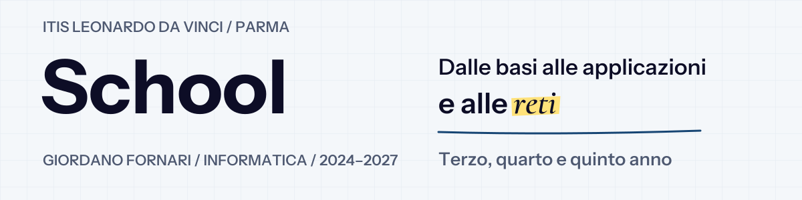
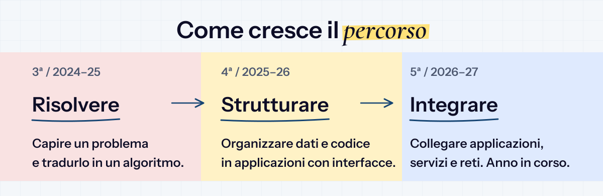
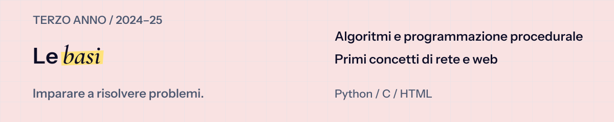
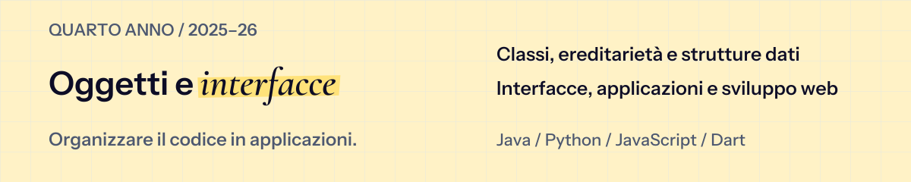

  

# School

Esercizi, laboratori e verifiche del mio **terzo, quarto e quinto anno di Informatica all’ITIS Leonardo da Vinci di Parma**, organizzati per anno e materia.

**[Terzo anno](#terzo-anno) · [Quarto anno](#quarto-anno) · [Quinto anno](#quinto-anno)**

**Struttura delle cartelle:** anno → materia → attività.

## Terzo anno

| Area | Argomenti e materiale |
| :--- | :--- |
| [Informatica](3-anno_2024-25/Informatica) | Python: variabili, condizioni, cicli e funzioni. |
| [Sistemi e reti](3-anno_2024-25/Sistemi) | C, compilazione e modelli di comunicazione in rete. |
| [Tecnologie informatiche (TPSIT)](3-anno_2024-25/TPSIT) | HTML e script batch. |
| [Sicurezza (Attacco-Difesa)](3-anno_2024-25/Attacco-Difesa) | Analisi e difesa di servizi. |
| [Formazione in università (PCTO)](3-anno_2024-25/PCTO) | Python all’Università di Parma. |

## Quarto anno

| Area | Argomenti e materiale |
| :--- | :--- |
| [Informatica](4-anno_2025-26/Informatica) | Java e Python a oggetti; interfacce e applicazioni con Dart e Flutter. |
| [Sistemi e reti](4-anno_2025-26/Sistemi) | Strutture dati in C. |
| [Tecnologie informatiche (TPSIT)](4-anno_2025-26/TPSIT) | JavaScript, form e applicazioni client. |
| [Attività estive](4-anno_2025-26/Estate) | Programmazione e simulazione di reti. |

## Quinto anno

| Area | Argomenti e materiale |
| :--- | :--- |
| [Informatica](5-anno_2026-27/Informatica) | Programmazione a oggetti, C# e interfacce desktop con Windows Forms. |
| [Sistemi e reti](5-anno_2026-27/Sistemi) | Subnetting, progettazione di reti e IoT con Packet Tracer. |
| [Tecnologie informatiche (TPSIT)](5-anno_2026-27/TPSIT) | Node.js, server web e gestione dei flussi di dati. |
