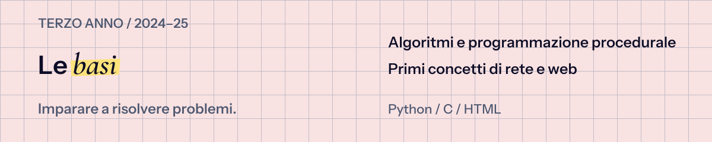
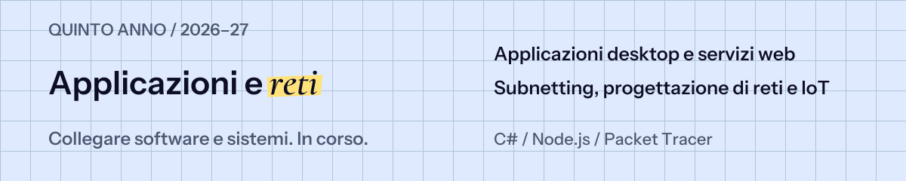

  

Esplora tre anni di Informatica attraverso il codice scritto a scuola: esercizi, laboratori e verifiche. Il percorso mostra come si passa dai primi algoritmi alla costruzione di applicazioni, servizi e reti.

**[Terzo anno](#terzo-anno) · [Quarto anno](#quarto-anno) · [Quinto anno](#quinto-anno)**

| Area | Cosa esplorare |
| :--- | :--- |
| [Informatica](3-anno_2024-25/Informatica) | Sequenze, condizioni, cicli e funzioni in Python. |
| [Sistemi e reti](3-anno_2024-25/Sistemi) | Compilazione in C e modelli di comunicazione in rete. |
| [TPSIT](3-anno_2024-25/TPSIT) | Pagine HTML e script batch. |
| [Sicurezza](3-anno_2024-25/Attacco-Difesa) | Challenge, analisi e difesa di servizi. |
| [PCTO universitario](3-anno_2024-25/PCTO) | Attività Python all’Università di Parma. |

| Area | Cosa esplorare |
| :--- | :--- |
| [Informatica](4-anno_2025-26/Informatica) | Esercizi a oggetti, verifiche e laboratori con interfacce. |
| [Sistemi e reti](4-anno_2025-26/Sistemi) | Strutture dati in C. |
| [TPSIT](4-anno_2025-26/TPSIT) | Form, client e script JavaScript. |
| [Attività estive](4-anno_2025-26/Estate) | Approfondimenti di programmazione e simulazione di reti. |

| Area | Cosa esplorare |
| :--- | :--- |
| [Informatica](5-anno_2026-27/Informatica) | Console, librerie di classi e Windows Forms. |
| [Sistemi e reti](5-anno_2026-27/Sistemi) | Indirizzamento, sottoreti e simulazioni in Packet Tracer. |
| [TPSIT](5-anno_2026-27/TPSIT) | Server HTTP e flussi di dati con Node.js. |
