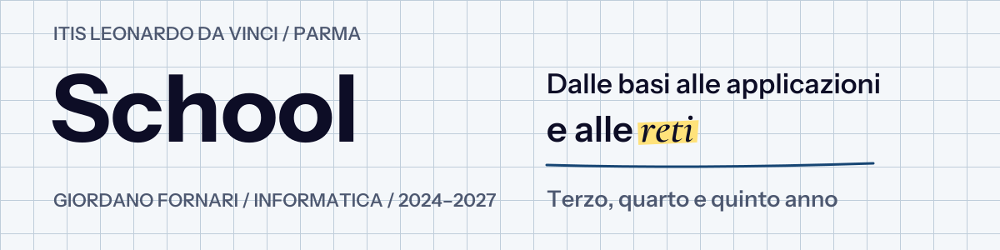

  

Esercizi, laboratori e verifiche. **Cartelle: anno → materia → attività.**

**[Terzo anno](#terzo-anno) · [Quarto anno](#quarto-anno) · [Quinto anno](#quinto-anno)**

[Informatica](3-anno_2024-25/Informatica) · [Sistemi e reti](3-anno_2024-25/Sistemi) · [TPSIT](3-anno_2024-25/TPSIT) · [Sicurezza](3-anno_2024-25/Attacco-Difesa) · [PCTO universitario](3-anno_2024-25/PCTO)

[Informatica](4-anno_2025-26/Informatica) · [Sistemi e reti](4-anno_2025-26/Sistemi) · [TPSIT](4-anno_2025-26/TPSIT) · [Attività estive](4-anno_2025-26/Estate)

[Informatica](5-anno_2026-27/Informatica) · [Sistemi e reti](5-anno_2026-27/Sistemi) · [TPSIT](5-anno_2026-27/TPSIT)
